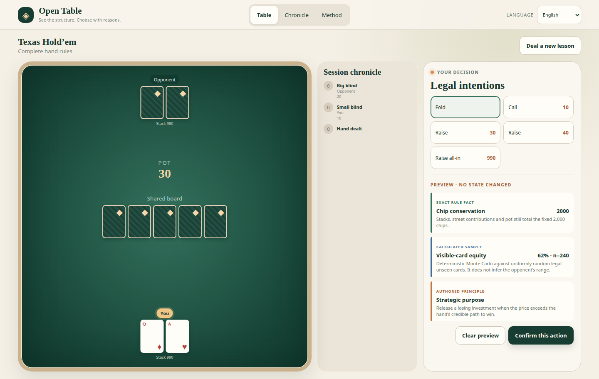

[English](../README.md) · [العربية](README.ar.md) · [Español](README.es.md) · [Français](README.fr.md) · [日本語](README.ja.md) · [한국어](README.ko.md) · [Tiếng Việt](README.vi.md) · [中文 (简体)](README.zh-Hans.md) · [中文（繁體）](README.zh-Hant.md) · [Deutsch](README.de.md) · [Русский](README.ru.md)

[](https://lazying.art)

# LazyPoker · Open Table

*合法な選択肢と根拠を確認し、1つの行動だけを明示的に確定します。*

[](https://lazying.art) [](../docs/images/app.png) [](https://github.com/sponsors/lachlanchen)

LazyPoker は、完全なヘッズアップ Texas Hold’em 1ハンドと、範囲を明示した Contract Bridge／Guandan 入門テーブルをローカルで学べる意思決定教材です。決定論的コードがルール、情報の秘匿、得点、履歴、永続化を担当します。

## オープンな教育ツールをサポート

| Donate | PayPal | Stripe |
| --- | --- | --- |
| [](https://chat.lazying.art/donate) | [](https://paypal.me/RongzhouChen) | [](https://buy.stripe.com/aFadR8gIaflgfQV6T4fw400) |

## アプリのプレビュー

[](../docs/images/app.png)

学習テーブルは、汎用的な「パワー」表示ではなく、ゲームごとのコンパクトな意思決定ツールを備えます。

- Hold’em はボードと価格の地図で、公開テクスチャ、可視カードのエクイティ、次の1枚による改善候補、コール価格、実効スタック、候補ごとの投入を示します。
- Bridge はトリックコンパスで、リードスート、固定切札、見える現在勝者、フォロー義務、プレビュー札のランクコストを示します。
- Guandan は主導権キューで、応答順、勝つための閾値、合法な勝ち札、公開チーム枚数、高札の温存コストを示します。

自分の各ターンに透明な教学提案が表示されます。ホバー、フォーカス、タップは状態を変えずにプレビューし、右クリックまたは `Esc` で解除でき、確認ボタンだけが行動を確定します。

## プレイ可能なものは何ですか

- Texas Hold’em: ブラインド、4 つのベッティング ストリート、オールイン プレイ、フォールド、ショーダウン評価、ポット決済を備えた完全なヘッズアップ ノーリミット ハンド。
- Contract Bridge: スートフォロー、スペード固定切り札、トリックの勝者、パートナーとのタイミングを学ぶ5トリックの入門テーブル。ビッド、ダミー、コントラクト、デュプリケート得点は対象外です。
- Guandan: イニシアチブ、パス、パートナー認識のための 6 枚のカードのシングル専用の初心者テーブル。コンビネーション、ボム、トリビュート、レベルワイルドカード、プロモーションスコアはこのレッスンの対象外です。
- すべてのモードで同じ学習手順を使います。決定論的ルールエンジンが提示する合法な選択肢を調べ、状態を変えずにプレビューし、明示的に確定します。

## リポジトリマップ

| パス | 目的 |
| --- | --- |
| [`src/core/`](../src/core/) | 決定論的なカード、ルール、合法候補、状態遷移、情報の秘匿、評価、永続化。 |
| [`src/i18n/catalogs.ts`](../src/i18n/catalogs.ts) | 安定したキーとプレースホルダーを備えた 11 個の完全な学習者向けカタログ。 |
| [`src/core/decisionAnalysis.ts`](../src/core/decisionAnalysis.ts) | 公開観測だけから導く Hold’em・Bridge・Guandan の意思決定根拠。 |
| [`src/i18n/analysisCatalogs.ts`](../src/i18n/analysisCatalogs.ts) | 3種類のゲーム固有分析ツールの文脈翻訳。 |
| [`src/App.tsx`](../src/App.tsx) | 多言語の共通テーブル、プレビュー、確定、履歴、根拠表示のインターフェイス。 |
| [`docs/model-options.md`](../docs/model-options.md) | オプションのソルバーとモデルの選択と、その証拠と安全境界。 |
| [`docs/smoke-test.md`](../docs/smoke-test.md) | 反復可能なブラウザレビュー手順。 |
| [`docs/images/app.png`](../docs/images/app.png) | 現在のアプリケーションのスクリーンショット。 |

## クイックスタート

Node.js `^20.19.0` または `>=22.12.0` と npm が必要です。

```bash
npm ci
npm run dev
```

<http://127.0.0.1:8020/>

Vite が表示したローカル URL を開きます。開発ポートは 8020 に固定されており、使用中なら別ポートへ移らず安全に失敗します。

## 正確性、プライバシー、根拠

- 公開画面では、表示前にデッキ順、シード、リクエスト記録、相手とパートナーの手札、非公開分析を隠します。
- 推測できない候補 ID は、正式な局面全体、行動者、正規アクションを結び付けます。古い候補や不明な選択は安全に拒否されます。
- プレビューは仮定であり、将来のコミュニティカードを明かしません。確定だけが状態を変更します。
- 厳密なルール、計算サンプル、著者による戦略は別々に表示します。Hold’em のエクイティは合法な未見カードを一様と仮定し、「改善札」は可視の完成ハンドを改善する候補であって勝利保証のアウトではありません。どちらも相手レンジの推定や GTO の主張ではありません。
- Bridge は自分の手札と既出札だけ、Guandan は自分の手札・現在札・公開枚数・応答キューだけを読みます。非公開状態だけを差し替えても意味上の分析は変わりません。

## 検証

```bash
npm run lint
npm test
npm run build
npm run audit
bash -n scripts/*.sh
bash scripts/test-model-safety.sh
git diff --check
```

テストは、決定論的配牌、カード一意性、得点とチップ保存、古い候補拒否、秘匿と非公開状態の非干渉、不透明なエージェントターン、冪等性、永続化競合、提案、解除可能で非変更のプレビュー、確定後の再計算、ゲーム固有ツール、ポート固定、11言語カタログの厳密な一致を対象にします。

## 引用

教育または研究で LazyPoker を使用する場合は、リポジトリを引用してください。 GitHub は [CITATION.cff](../CITATION.cff) を読み取り、「このリポジトリを引用」パネルを表示します。

```bibtex
@software{chen_lazy_poker_2026,
  author  = {Chen, Lachlan},
  title   = {LazyPoker: Hold'em, Contract Bridge, and Guandan Decision Teacher},
  year    = {2026},
  version = {0.1.0},
  url     = {https://github.com/lachlanchen/LazyPoker}
}
```

## 状態

Texas Hold’em は完全なヘッズアップ1ハンドです。Bridge と Guandan は初心者向け教材として明示され、競技ルールの完全実装を主張しません。任意のモデル連携は既定で無効です。
